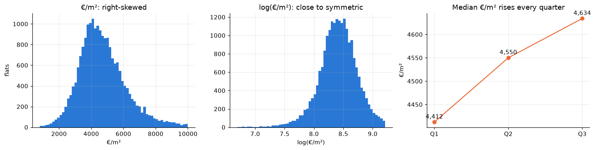
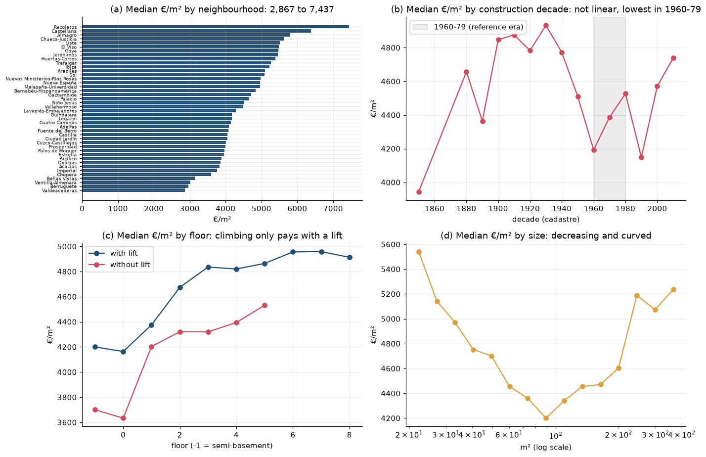
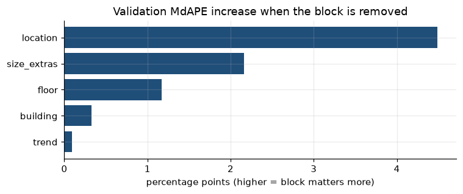
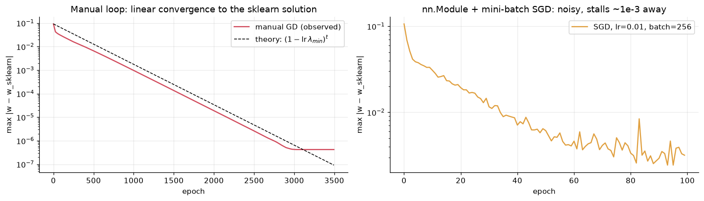

# Assignment 1 Report — Fair value of central-Madrid flats

- **Name**: Enrique Roca de Togores Pérez-Castro
- **Student ID**: 20044
- **Email**: erocadetogor.ieu2022@student.ie.edu
- **Group**: BBADBA 5B

**Run:** `uv run python main.py train` (≈2 min) then `uv run python main.py app`.
Training lives in `train.ipynb`, the dashboard in `app.py`, and the code both share (cleaning, features, metrics, the `nn.Module`) in `pipeline.py`.

## Dataset

**What:** every for-sale listing published on idealista.com in Madrid during 2018, from the open
[`idealista18`](https://github.com/paezha/idealista18) dataset (Rey-Blanco, Arbués & López, 2024). Idealista
publishes one snapshot per quarter, and the authors enriched each listing with cadastre data (construction year,
building height, number of flats in the building, cadastral quality).

**One row** = one listing ad in one quarter: asking price, m², rooms, bathrooms, floor, lift, terrace, condition,
distances to the city centre, the metro and Paseo de la Castellana, and coordinates.
**Size:** 94,815 rows × 41 columns for the whole city. `data/prepare_dataset.py` turns the original R files into the
committed `data/madrid_sale_2018.csv.gz` (7 MB) and `data/madrid_barrios.geojson` (the 135 neighbourhood polygons).

**Why this dataset:** valuing a flat with comparables is the property version of valuing a company with multiples,
which is the kind of problem I work on. Feature engineering really matters here: a linear model on the raw columns
misses that location, age, floor and size all affect price in non-linear ways.

Three facts from the publisher's anonymisation code shape the whole analysis:
- prices carry random ±2.5% noise and are rounded to €1,000 → an error floor no model can beat;
- coordinates were moved 30–60 m but always **within the same neighbourhood**, so I can recover the neighbourhood;
- ads above €10,444/m², under €5k or over €4M were removed → the luxury top is cut off.

## Business / real-life framing

Consider a buy-to-let investor who receives hundreds of new property listings every quarter in central Madrid but can
only visit a small number of them. The model estimates the fair asking price per square metre of each flat, so the
investor can prioritise listings advertised well below their estimated value. This is similar to comparing companies
with valuation multiples such as EV/EBITDA: price per square metre is the benchmark multiple, adjusted for each
property's characteristics.

The target variable is log(price per square metre). Dividing by m² makes properties of different sizes comparable, the
log reduces skewness, and the coefficients can be read approximately as percentage premiums. A time-based split is
essential because the model must value properties listed after its training period, and asking prices in the data rose
by about 2.5% per quarter during 2018. Model selection therefore trains on Q1–Q2 and validates on Q3, while the final
model is trained on Q1–Q3 and evaluated once on Q4. A random split would leak future prices into training. For the same
reason the time trend is a number from 0 to 3: a Q4 dummy could never be learned, because Q4 never appears in training.

Performance is measured with MdAPE (median absolute percentage error) and PPE10 (share of properties valued within
±10%), because an error of 10% matters as much on a €200,000 flat as on a €1 million one. The analysis covers districts
01–07, properties up to 400 m² and one observation per property.

A listing qualifies as a potential bargain when its asking price is at least 20% below its estimated fair value. This
threshold is the 90th percentile of the discounts on the validation quarter and about 1.7 times the model's typical
error (MdAPE). A 45% cap, the 99th percentile, filters out implausible cases. Assuming a cost of €400 per visit, this
focuses due diligence on the most promising opportunities.

## Data preparation & feature engineering

**Cleaning** (simple row filters that learn nothing from the data, so they can run before the split):

| Step | Rows after | Why |
|---|---|---|
| Coordinates outside Madrid | 94,721 | fall in no neighbourhood polygon (some are 400 km away) |
| Universe: central almond | 45,245 | the investor's market |
| One flat = one row | 36,203 | the same `ASSETID` appears up to 3 times in the **same quarter** at different prices: the same flat listed by several agencies. I keep the cheapest (the price a buyer could get). Otherwise the flat would count up to three times, and any random split could put copies on both sides. |
| Zero bathrooms | 36,163 | data-entry errors |
| Over 400 m² | **35,750** | whole buildings and mansions, outside the mandate |

Split sizes: Q1–Q2 14,033 / Q3 6,744 (selection); Q1–Q3 20,777 / Q4 14,973 (final).

**Other data-quality decisions.**
- The advertiser's `CONSTRUCTIONYEAR` is 59% missing with impossible values (year 1, 2291) → dropped; the cadastre's `CADCONSTRUCTIONYEAR` is complete.
- `PARKINGSPACEPRICE` is a placeholder (1) in 98% of rows → dropped.
- `UNITPRICE` = `PRICE / CONSTRUCTEDAREA` is the target → never a feature (leakage).
- Missing floor (3%) or exterior/interior (5%) → training median **plus a 0/1 "unknown" flag**.
- The neighbourhood is not in the data → recovered by point-in-polygon on the idealista polygons.

**Features: evidence first.** Each block answers a pattern in the training data that a straight line on the raw
columns cannot draw:

| Block | Features | Pattern it answers |
|---|---|---|
| trend | `t_quarter` | prices rise every quarter |
| location | one dummy per neighbourhood (42, one reference); log distance to Castellana, Sol and metro | (a) neighbourhood medians range from €2,867 to €7,437/m²; distances matter most over the first hundreds of metres |
| building | construction-era dummies (reference 1960–79), cadastral quality, new build, needs renovation, log building height, log flats in building, doorman | (b) age is not linear: pre-war and recent buildings are worth more than 1960–79 blocks |
| floor | floor, `floors_without_lift` = floor × no lift, ground floor, semi-basement, top floor, exterior, south-facing, unknown flags | (c) a high floor only pays with a lift: an interaction |
| size & extras | log m² and its square (centred at 90 m²), m² per room, baths per room, studio, duplex, terrace, AC, storage, wardrobes, pool, garden, parking included in price, kitchen/furniture | (d) €/m² vs size is U-shaped |

81 features in total, standardised with the **training** mean and standard deviation. Everything learned from data
(medians, neighbourhood list, means/stds) is fitted on training rows only, inside `FeatureBuilder`, and reused unchanged
by the dashboard.

**Did it work? (validation quarter Q3)**

| Candidate | Features | RMSE (log) | R² (log) | MdAPE | PPE10 |
|---|---|---|---|---|---|
| Baseline: global median €/m² | 0 | 0.314 | −0.01 | 19.5% | 25.7% |
| Baseline: neighbourhood median €/m² ("comps") | 0 | 0.252 | 0.35 | 15.0% | 34.5% |
| Linear regression, raw columns | 34 | 0.242 | 0.40 | 14.4% | 35.6% |
| **Linear regression, engineered features** | 81 | **0.206** | **0.56** | **11.4%** | **44.7%** |

The raw-column regression barely beats the comps rule of thumb; the engineered one cuts the typical error by 3.5 points.

**Ablation** (remove one block, re-score on Q3): every block earns its place. Location matters most
(+4.5 pp MdAPE without it), then size & extras (+2.2 pp), floor (+1.2 pp) and building (+0.3 pp). Removing the trend
moves MdAPE by only +0.1 pp but makes the model **undervalue Q3 by 3.4%** at the median: the error becomes systematic.

**Choices tested during development and dropped:** target-encoding the neighbourhood (one number per neighbourhood) was worse than
one-hot dummies, because each neighbourhood has 300+ flats and nothing needs compressing. Extra interactions (size ×
distance, renovation × size) added less than 0.001 RMSE and were not kept.

## Modeling: three implementations, one model

**Model: linear regression**, because the target (log €/m²) is continuous. **Regularisation:** Ridge with α from 1 to
10,000 never beat plain least squares on validation (best gain 0.00001 RMSE). With ~14,000 rows for 81 features there is
nothing to shrink, so all three implementations fit **plain linear regression, minimising the mean squared error**.

1. **scikit-learn `LinearRegression`**: the exact least-squares solution in one step.
2. **PyTorch by hand**: tensors `w`, `b` at zero; each epoch computes `loss = mean((X@w + b − y)²)`, calls
   `loss.backward()`, updates `w -= lr·w.grad` inside `torch.no_grad()`, and zeroes the gradients. Full batch.
   Learning-rate sweep on the selection split: 0.3 explodes, 0.01 is too slow, 0.1 and 0.2 converge → **lr = 0.1**
   (half the largest stable value, as a safety margin), **4,000 epochs**.
3. **Standard workflow**: `LinearRegressionModel(nn.Module)` with one `nn.Linear`, `nn.MSELoss`, `torch.optim.SGD`,
   `DataLoader` with shuffled **mini-batches of 256**. Sweep → **lr = 0.01**, 100 epochs.

**Results on the Q4 test quarter (14,973 listings, never used before):**

| Method | RMSE (log) | R² (log) | MdAPE | PPE10 | PPE20 | Median bias | Train time |
|---|---|---|---|---|---|---|---|
| Baseline: global median | 0.308 | −0.01 | 18.8% | 27.4% | 52.5% | −3.4% | – |
| Baseline: neighbourhood median | 0.248 | 0.35 | 14.7% | 35.2% | 64.3% | −3.1% | – |
| scikit-learn LinearRegression | 0.2027 | 0.564 | 11.44% | 44.75% | 75.64% | +0.96% | 0.1 s |
| PyTorch manual loop | 0.2027 | 0.564 | 11.44% | 44.75% | 75.64% | +0.96% | 3 s |
| PyTorch nn.Module + SGD | 0.2030 | 0.563 | 11.40% | 44.75% | 75.52% | +0.89% | 28 s |

**Do the three agree? Yes.** They minimise the same loss on the same matrix, so they should find the same weights;
the remaining gaps come only from *how* each one searches:

| vs scikit-learn | Largest weight difference | Median / max difference in predicted price |
|---|---|---|
| Manual loop (full-batch GD) | 4.9 × 10⁻⁷ | 0.0002% / 0.0004% |
| nn.Module (mini-batch SGD) | 3.3 × 10⁻³ | 0.58% / 3.3% |

- The **manual loop** uses all the data at every step, so it gets closer every epoch and ends at float32 rounding level.
- **Mini-batch SGD** estimates the gradient from 256 flats at a time. Each step points roughly the right way, so it
  gets close and then wobbles around the exact answer. With a constant learning rate it never settles exactly. The
  wobble is 0.6% on the typical predicted price, small next to an 11% valuation error, and the business metrics match
  within 0.1 points. With full batches and the same learning rate it would match the manual loop exactly.

**A bias shared by all three.** Every model overvalues Q4 by about 1%. The trend learned on Q1–Q3 is +2.1% per
quarter, but the median only rose 1.1% from Q3 to Q4, so the extrapolation overshoots.

**The bargain screen on Q4:** with *d* = 20% and the 45% cap, 1,459 listings (9.7%) are flagged, which at an assumed
€400 per visit means €583,600 of due diligence. 167 listings are set aside as implausible. These are discounts of 80%
or more, such as €900/m² in Recoletos where the median is above €7,400/m²: bare ownership (*nuda propiedad*), auctions,
occupied flats or typos, which the data cannot identify. Flats needing renovation and interior flats are flagged at their
normal rate (the model prices them in). Ground-floor flats (16% of flags vs 11% of listings) and Centro (13.2% of its listings flagged vs 9.7% overall) are over-represented,
which points to factors the model cannot see. That is why the output is a visit list, not a buy list. The dashboard lets
the user move *d*, the cap and the cost per visit.

## Results and key findings

**Feature engineering drives the improvement.** Using the original columns alone barely beats the baseline of the
median price per m² in each neighbourhood: on the validation set the error only drops from 15.0% to 14.4%. With the
engineered features it falls to 11.4%. The test set confirms it: the error goes from 14.7% to 11.4%, and the share of
properties valued within ±10% of their asking price rises from 35% to 45%.

**Location is the most important factor.** Removing it raises the validation error by 4.5 percentage points. Next come
property size and extras (+2.2 points), floor level and lift, including their interaction (+1.2 points), and building
characteristics (+0.3 points).

**The market trend barely changes the typical error, but it prevents a systematic bias.** Without it, the model
undervalues the validation quarter by 3.4%, roughly the market's price rise. Including the trend lets the model account
for prices moving over time.

**Regularisation brings no noticeable improvement.** Ridge regression performs no better than plain linear regression.
With around 170 properties per feature there is no sign of overfitting, so regularisation is not necessary.

**All three training methods produce almost identical results.** The manual PyTorch loop reaches the same solution as
scikit-learn, apart from tiny rounding differences. Mini-batch SGD is also very close: the estimated price of a typical
property differs by 0.6%, because of the noise introduced by mini-batches. In practice, the business metrics are the
same for all three methods.

**All three models overestimate Q4 prices by around 1%.** They learned an average price increase of 2.1% per quarter,
while the market only rose 1.1% from Q3 to Q4. This gap explains most of the overestimation in that quarter.

**The bargain detector is a tool to decide which properties to visit, not which to buy.** With a 20% threshold it flags
1,459 properties, about €583,600 in viewing costs at an assumed €400 per visit. It also sets aside 167 implausible
listings whose discounts are too large to be genuine bargains: most likely bare ownership, auctions, occupied flats or
typos, which would only waste visits.

Ground-floor apartments and properties in the Centro district appear more often than average among the flagged
listings. This suggests that the model is missing factors specific to these property types or locations. The flagged
opportunities should therefore be reviewed individually before any purchase decision.

## Limitations & next steps

**Asking prices versus transaction prices.** The model uses asking prices rather than completed transaction prices,
which are typically lower, and the gap varies across neighbourhoods. The model should be recalibrated with actual
transaction data from notaries or the Spanish Land Registrars Association (Registradores).

**Unusual listings in the training data.** Bare-ownership, auction and occupied properties may distort the regression,
even though the screening process excludes them from the final shortlist. These listings should be identified from the
listing descriptions, or handled with a loss function that is less sensitive to outliers, such as the Huber loss.

**Linear time trend.** The model overestimated the Q4 price increase: it learned a quarterly increase of 2.1%, while the
observed increase was 1.1%. The trend should be re-estimated every quarter or replaced with an official housing price
index, such as the one published by Spain's National Statistics Institute (INE).

**Unobserved property quality.** Natural light, views, noise and the actual condition of the property are not captured,
which may explain part of the 11% prediction error and some of the false bargains. Information extracted from listing
photographs and descriptions could improve valuation accuracy.

**Limited coverage of the luxury segment and price noise.** Listings above €10,444/m² were excluded by the publisher,
which also added random noise of up to ±2.5% to every price to anonymise the data. The model should therefore not be
used to value prime properties in areas such as Salamanca or Recoletos without additional data and segment-specific
calibration.

**Limited historical coverage.** The model is based on a single year of data, so coefficients estimated in 2018 may no
longer reflect current market conditions. The model should be retrained every quarter, with prediction errors and
systematic bias monitored over time.

## Generative AI use disclosure

This project was joint work with Claude (Anthropic), used as an assistant throughout:
- **Code:** Claude wrote most of the code (data preparation script, `pipeline.py`, `train.ipynb`, `app.py`), including the plots
  and the Gradio layout, following the decisions below.
- **Decisions:** I chose the dataset (idealista Madrid), the target (log €/m²), the universe (central almond) and the time-based
  split. For the business framing and the feature blocks, Claude proposed options with their reasoning. I selected the
  location-and-trend block myself and adopted Claude's recommendation for the framing and the remaining blocks after reviewing
  the reasoning; the validation results (ablation and regularisation check) then confirmed each of them, and decided the switch
  from target encoding to one-hot neighbourhoods.
- **Report:** Claude drafted the Dataset, Data preparation & feature engineering and Modeling sections from the results.
  The Business / real-life framing, Results and key findings, and Limitations & next steps sections are my own writing,
  based on an outline of the key points and figures that Claude prepared; Claude then corrected the grammar, clarified a
  few sentences and checked every figure against the results.
- **Reproduction:** I set up the environment with `uv sync` and ran `main.py train` and `main.py app` end to end on my
  own laptop (macOS); the results matched the committed ones exactly.
- I have reviewed the whole project and can explain every decision and number in it.
